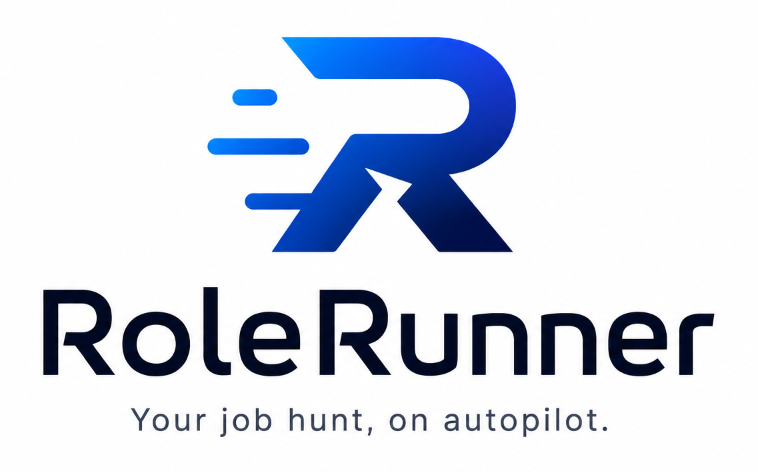

<p align="center">
  
</p>

<p align="center">
  <strong>Your job hunt, on autopilot.</strong><br>
  Autonomous AI job scouting, ATS-tailored resume generation, and application pipeline orchestration.
</p>

<p align="center">
  
  
  
  
  
  
</p>

---

## 🚀 Overview

**RoleRunner** is an open-source, full-stack career acceleration platform designed to automate the repetitive aspects of job hunting without requiring expensive API keys. By leveraging the OpenAI Codex CLI device-auth harness alongside an async Python backend and dark-mode React interface, RoleRunner handles candidate profile parsing, intelligent multi-board job discovery, ATS keyword match scoring, tailored CV creation, and pipeline tracking.

---

## ✨ Key Features

- 🔑 **Zero-API-Key AI Engine**: Leverages your existing ChatGPT subscription via isolated Codex CLI device authentication. Connect with a one-time browser code, or disconnect/switch accounts anytime with a single click.
- 📄 **Universal Profile Ingestion**: Upload resumes in PDF, DOCX, Markdown, or JSON. Extracted data is structured into master candidate profiles using AI with deterministic heuristic regex fallbacks.
- 🔎 **Multi-Board Job Scouting**: Aggregates opportunities from Greenhouse, Lever, Ashby, direct career portals, and DuckDuckGo web search with automatic deduplication.
- 🎯 **ATS Relevance & Gap Analysis**: Evaluates job descriptions against your master profile, computing semantic keyword scores, identifying missing skill gaps, and classifying opportunities (*Strong Match*, *Good Match*, *Partial Match*).
- ✍️ **Tailored CV Generation**: Generates customized resumes tailored to specific job postings, optimizing keyword frequency and phrasing for Applicant Tracking Systems (ATS).
- 📦 **Multi-Format Export & Packager**: Exports generated resumes into high-quality PDFs (ReportLab), formatted Markdown, and reviewable ATS copy-paste packs (`fields.md` / `answers.json`).
- 📊 **Application Kanban Tracker**: Tracks applications across stages (*Saved* → *Applied* → *Interviewing* → *Offer* / *Rejected*) with quick status advancing and metrics.
- ⚡ **Real-Time SSE Event Streaming**: Live Server-Sent Events (SSE) keep the workspace updated on background tasks, scraping progress, and agent heartbeats.
- 🤖 **Model Context Protocol (MCP) Server**: Exposes stdio tools for LLM agent integration to automate searching, scoring, and CV building programmatically.

---

## 🏗️ Architecture

```
RoleRunner/
├── backend/
│   ├── main.py                # FastAPI app factory & lifespan
│   ├── config.py              # Pydantic Settings & environment config
│   ├── db/                    # SQLAlchemy 2.0 async engine, models, & session
│   ├── repositories/          # Tenant-isolated repository pattern
│   ├── routers/               # API endpoints (profile, jobs, cv, applications, agent)
│   ├── scrapers/              # Greenhouse, Lever, Generic, DDG searchers with SSRF guard
│   ├── services/              # Profile parsing, job scorer, CV generator, storage, redis
│   └── mcp/                   # Model Context Protocol stdio server
├── frontend/                  # Vite 6 + React 19 SPA
│   ├── src/components/        # AppShell, ProviderStatus, Navigation
│   ├── src/pages/             # Dashboard, Profile, JobSearch, CVBuilder, Applications
│   └── public/                # Logo, icons, and favicons
├── tests/                     # Pytest suite (async backend & services tests)
├── docker-compose.yml         # Multi-container stack (backend, frontend, postgres, redis)
├── pyproject.toml             # uv/Python dependencies & tool configurations
└── Makefile                   # Common development commands
```

---

## ⚡ Quick Start

### Prerequisites

- [Python 3.13+](https://www.python.org/) and [`uv`](https://docs.astral.sh/uv/) package manager
- [Node.js 20+](https://nodejs.org/) & `npm`
- [OpenAI Codex CLI](https://github.com/openai/codex) (for AI features)

### 1. Installation

```bash
# Clone repository
git clone https://github.com/your-username/rolerunner.git
cd rolerunner

# Install backend + frontend dependencies and pre-commit hooks
make install
```

### 2. Run Local Development Servers

```bash
# Start backend on :8000 and frontend on :5173 concurrently
make dev
```

Or run services individually:

```bash
# Backend server (FastAPI with auto-reload)
make dev-backend

# Frontend server (Vite dev server)
make dev-frontend
```

Open [http://localhost:5173](http://localhost:5173) in your browser to launch RoleRunner.

---

## 🔐 AI Provider Connection (Codex Device Auth)

RoleRunner uses isolated device authentication so you don't need to configure OpenAI API keys:

1. In the RoleRunner Dashboard, click **"Connect Codex"** in the AI Provider widget.
2. A one-time device code and authorization link will appear.
3. Click **"Open sign in"**, paste the device code into the browser prompt, and approve access.
4. RoleRunner automatically detects authentication and enables AI-assisted resume parsing and CV tailoring.
5. You can click **"Disconnect session"** at any time to remove tokens or connect another account.

---

## 🐳 Docker Deployment

To launch the full production-ready stack (FastAPI Backend + Nginx/React Frontend + PostgreSQL 16 + Redis 7):

```bash
# Start all containers in background
docker compose up -d

# View live service logs
docker compose logs -f
```

- **Frontend**: [http://localhost:3000](http://localhost:3000)
- **Backend API**: [http://localhost:8000](http://localhost:8000)
- **API Documentation**: [http://localhost:8000/docs](http://localhost:8000/docs)

---

## 🛠️ Testing & Quality

```bash
# Run linting and code formatting checks
make lint

# Run type checks with Mypy
make typecheck

# Run full pytest test suite
make test

# Run tests with terminal coverage report
make test-cov
```

---

## 🔌 MCP Integration (Cursor / Claude Desktop)

RoleRunner provides a built-in Model Context Protocol (MCP) stdio server. To connect it to your MCP client:

```json
{
  "mcpServers": {
    "rolerunner": {
      "command": "uv",
      "args": ["run", "python", "-m", "backend.mcp.server"],
      "cwd": "/path/to/rolerunner"
    }
  }
}
```

Available MCP Tools:
- `search_jobs`: Query job listings across multi-board and web engines.
- `score_job`: Score a CV against a job description.
- `generate_tailored_cv`: Generate an ATS-optimized CV draft.
- `get_candidate_profile`: Retrieve the tenant's structured profile.

---

## 📄 License

MIT License © 2026 RoleRunner Contributors.
